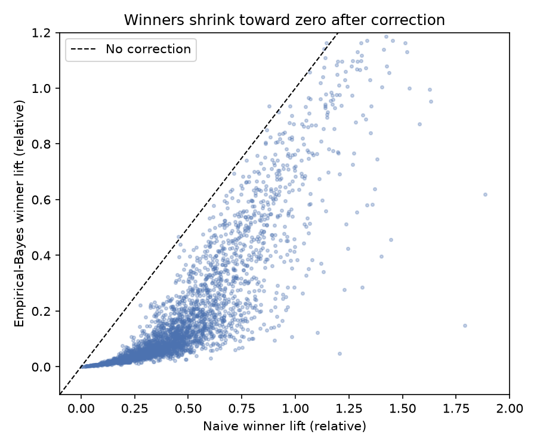
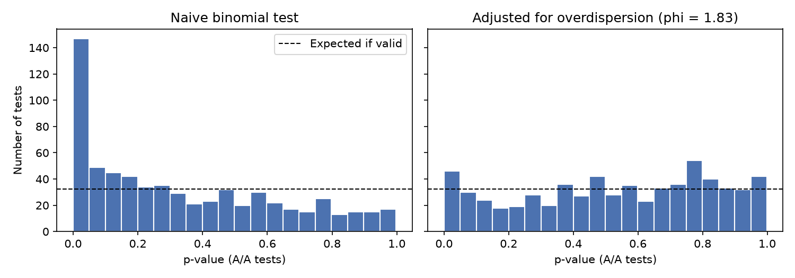

# What 3,800 Real A/B Tests Reveal About the Winner's Curse

An analysis of the [Upworthy Research Archive](https://upworthy.natematias.com/), a public dataset of headline A/B tests run by the news site Upworthy in 2013–2015.

**Question:** when a company runs thousands of A/B tests and ships the arm with the highest click-through rate, how much of the reported improvement is real?

## Key findings

| | Result |
|---|---|
| Broken randomization | **70%** of tests from Jun 2013 – Jan 2014 fail a sample-ratio-mismatch check (vs **0.5%** elsewhere); that period is excluded |
| Hidden A/A tests | **17%** of tests compare arms with the same headline *and* image, giving a built-in placebo group |
| Naive p-values are too optimistic | The standard binomial test flags **23%** of A/A tests at p < 0.05 (should be 5%). CTRs are overdispersed (φ = 1.83); after correcting, the A/A rate drops to **7%** |
| Fewer real winners | Significant tests fall from **1,550** to **767** of 3,176 after the correction (541 survive FDR control at q < 0.10) |
| Underpowered tests | With ~3,100 impressions per arm and a 1.3% CTR, a test can only reliably detect a **~80%** relative lift |
| Winner's curse | The average naive winner lift is **47%**; the empirical-Bayes estimate is **19%**, about **2.5×** smaller |
| Luck alone | In A/A tests (true lift = 0) the naive "winner" still shows a **29%** lift; EB cuts this to 7% |
| Validation | In simulations with known truth, the naive estimate is biased by **+25 pts**; EB is within **1 pt** |





## Method

1. **Data quality** — sample-ratio-mismatch (SRM) test per experiment; drop the documented problem period.
2. **Calibration** — use tests with identical arms (A/A) to measure the false-positive rate and estimate the overdispersion factor φ.
3. **Multiple testing** — Benjamini-Hochberg FDR control and Storey's π₀ across all experiments.
4. **Power** — minimum detectable effect and required sample size given observed CTRs and φ.
5. **Winner's curse** — fit a spike-and-slab empirical-Bayes prior to ~15,000 arm-level deviations:
   θ ~ π₀·δ₀ + (1 − π₀)·N(0, τ²), with observation noise φ·p(1 − p)/n.
   Shrink each winner's lift to its posterior mean; check the prior on A/A tests (π₀ ≈ 98%) and validate bias by simulation.

## Recommendations

- Forecast impact with shrunken lifts, not raw winner lifts.
- Run periodic A/A tests and correct p-values for overdispersion.
- Size experiments for the effects that actually occur; most tests here could only detect very large changes.
- Control the false discovery rate when many tests run at once.

## Repository

```
sql/01_build_tables.sql          DuckDB SQL: raw packages -> tests and arms tables with quality flags
src/upworthy.py                  statistics helpers (SRM, overdispersion, BH, empirical Bayes, simulation)
notebooks/01_explore.ipynb       first look at the data
notebooks/02_data_quality.ipynb  test types, SRM, clean sample
notebooks/03_significance_and_power.ipynb   A/A calibration, multiple testing, power
notebooks/04_winners_curse.ipynb winner's curse, empirical-Bayes correction, simulation check
report/figures/                  figures used above
```

## Reproduce

```bash
python3 -m venv .venv && source .venv/bin/activate
pip install -r requirements.txt
```

Download `upworthy-archive-exploratory-packages-03.12.2020.csv` from [OSF](https://osf.io/jd64p/) into `data/`, then run the notebooks in order.

## Data

Matias, J.N., Munger, K., Le Quere, M.A. & Ebersole, C. (2021). The Upworthy Research Archive, a time series of 32,487 experiments in U.S. media. *Scientific Data*. Licensed CC BY 4.0. Only the exploratory sample is used here.
